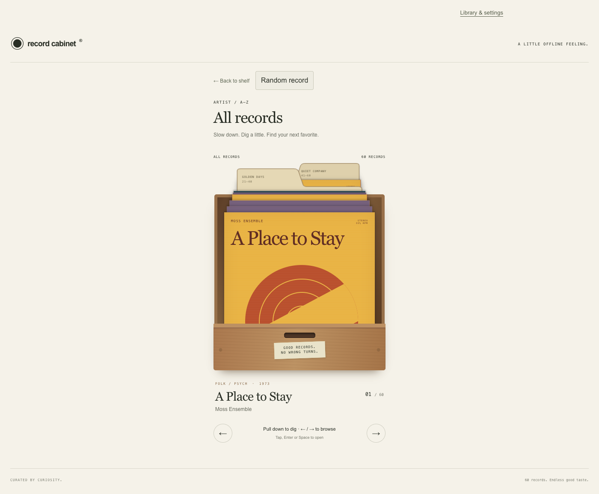

# Record Cabinet

A tactile, album-first music library for the web. Flip through record bins, pull out a sleeve, read the back cover, and put a record on the turntable.

**[Try the no-login demo](https://record-cabinet-livid.vercel.app/?demo=1)** · [Architecture](docs/architecture.md) · [Testing](docs/public-beta.md) · [Spotify setup](docs/spotify-setup.md)

The goal is to preserve the pleasure of browsing a physical collection while removing its space and cost constraints. This is a functional beta; Spotify integration is available to invited accounts, while the demo works without Spotify.



[Mobile screenshot](docs/images/demo-390.png)

## Features

- Touch, mouse, and keyboard browsing with paper dividers, remembered positions, random records, and a Recently added bin.
- Artist, album, genre, and custom organization, including non-Latin names.
- Integrated turntable with whole-album tonearm scrubbing and play/pause controls; playback persists between records and settings.
- Resumable Spotify imports with duplicate suppression and metadata caching.
- Local library persistence, collection backups, and account-scoped cloud synchronization.
- A no-login fictional catalog with original synthesized demo audio.

## Run locally

Use Node.js 22 and npm.

```sh
npm ci
npm run dev
```

Open http://127.0.0.1:3000. The demo needs no credentials. For Spotify, copy `.env.example` to `.env.local` and follow [Spotify setup](docs/spotify-setup.md). Never commit real credentials.

## Controls

Open a bin and drag through the sleeves, or use Left/Right. Tap a sleeve (Enter/Space) to lift it and reveal its back. Tap the vinyl peeking out to play. Tap the back or swipe down to return it; the track list scrolls separately. Divider tabs advance through a larger bin. The turntable arm scrubs across the album.

The public demo contains 60 fictional sleeves; the extra sleeves reuse the 15 original synthesized audio sketches. Open All records to try the divider tabs. Audio does not come from real artists. It demonstrates playback interaction rather than commercial music streaming.

## Engineering

Built with Next.js App Router, React, TypeScript, and Motion. IndexedDB preserves local collections and import checkpoints; server routes integrate Spotify and shared cloud storage. The application distinguishes library metadata from playable audio and keeps provider failures from removing saved records.

See [architecture and tradeoffs](docs/architecture.md) for persistent playback, motion rendering, import recovery, and testing boundaries.

## Validate

```sh
npm run lint
npm test
npm run build -- --webpack
```

GitHub Actions runs these checks on pushes and pull requests without production credentials. Standalone scripts in `scripts/*-smoke.cjs` cover browser interactions with mocked provider responses; see [testing](docs/public-beta.md).

## Status and feedback

Public demo testing and a small invited Spotify beta. Browser audio, background playback, and native media controls vary by device. Automated Spotify tests use mocks; passing them does not verify live streaming.

Use **Library & settings → Report a problem** to describe an issue and optionally attach diagnostics. Reports are reviewed and copied/downloaded by the user; nothing is sent automatically. Share reports with the project maintainer or through this repository's Issues once published. Do not post credentials or personal library backups.

[Deployment guide](docs/deployment.md) · [Privacy](https://record-cabinet-livid.vercel.app/privacy)
